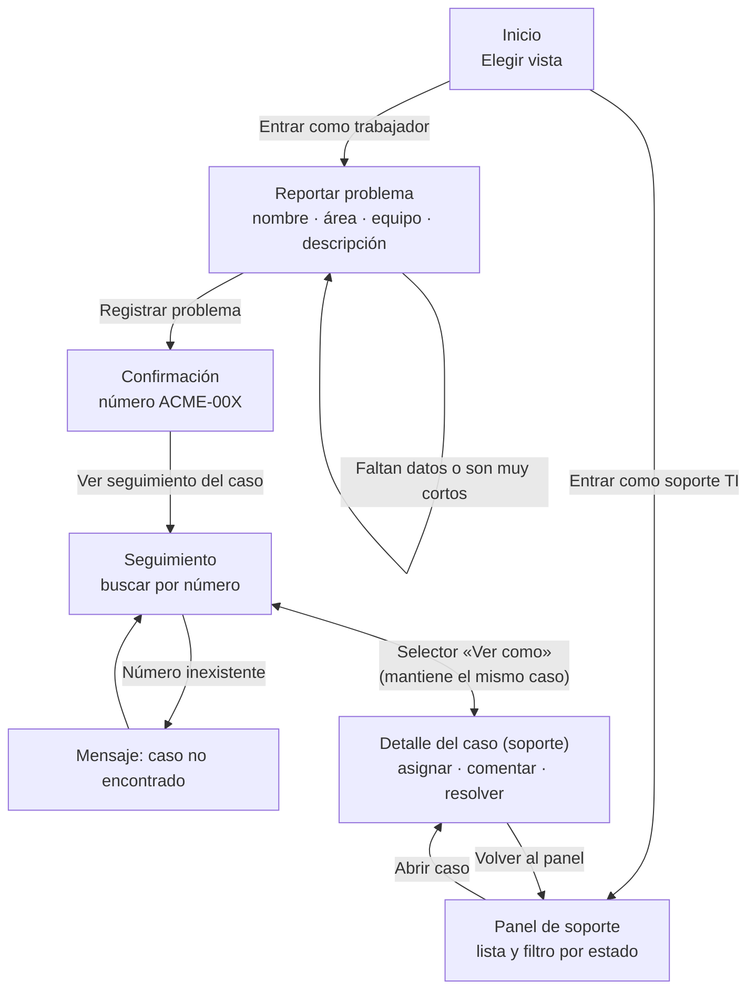
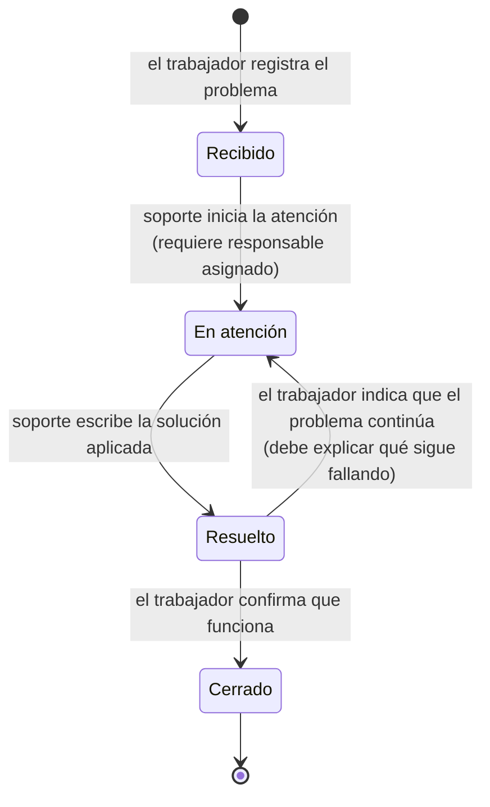

# Diagrama del recorrido

Mesa de ayuda ACME · Prototipo académico · Datos ficticios

## Pantallas y navegación



## Estados del caso



Cada transición queda registrada en el historial con fecha, hora y autor.
Soporte puede agregar comentarios mientras el caso no esté cerrado.

## Versión en texto (por si el visor no muestra diagramas)

```
Inicio ──► Trabajador ──► Reportar ──► Confirmación (ACME-00X) ──► Seguimiento
   │                        ▲  │                                       ▲
   │                        └──┘ errores: se conserva lo escrito       │ «Ver como»
   └──► Soporte TI ──► Panel (filtro por estado) ──► Detalle del caso ◄─┘

Recibido ──(responsable asignado)──► En atención ──(solución escrita)──► Resuelto
                                          ▲                               │   │
                                          └──── el problema continúa ─────┘   │
                                                                              ▼
                                                     el trabajador confirma ► Cerrado
```
